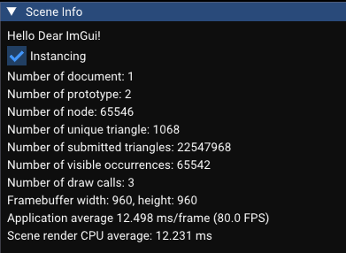

## 优化前
测试环境 Intel(R) Core(TM) i5-14400F (2.50 GHz) NVIDIA GeForce RTX 5060 (8 GB)

Release

使用 C:/Users/28025/Learn/model/chassis.step，新增测试用 axle 数量为 256x256

number of nodes: 65546

number of unique triangle: 1068

number of submitted triangle: 22547968

number of visible occurrences: 65542

number of draw call: 65542

Framebuffer size: 960, 960

RenderScene avg cpu time: 24.5 ms (平均)

## Instancing 优化后

number of nodes: 65546

number of unique triangle: 1068

number of submitted triangle: 22547968

number of visible occurrences: 65542

number of draw call: 3 (streetest中有正反两种)

Framebuffer size: 960, 960

RenderScene avg cpu time: 12.5 ms (平均)

## 全部被剔除时 (正确性验证)

number of nodes: 65546

number of unique triangle: 1068

number of submitted triangle: 0

number of visible occurrences: 65542

number of culled occurrences: 65542

number of draw call: 0

Framebuffer size: 960, 960

RenderScene avg cpu time: 8.8 ms (平均)

**Instancing / 非 Instancing 数据一致**

## Instancing + 同一视角开关Culling测试
(本测试中相机的 far = 700， 默认为 1000)
| Instancing | Culling | Submitted | Draw calls | Culled | Render time (ms)
|---|---|---:|---:|---:|---:|
| 开启 | 关闭 | 22547968 | 3 | 0 | 8.5 |
| 开启 | 开启 | 8196144 | 2 | 41716 | 8.4~8.5 |
| 关闭 | 关闭 | 22547968 | 65542 | 0 | 27.4 |
| 关闭 | 开启 | 8196144 | 23826 | 41716 | 15.6 |