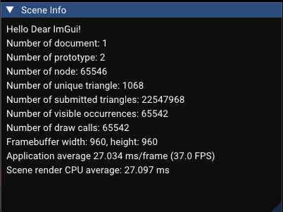
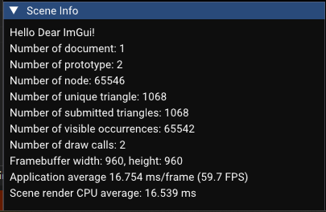

## 优化前
测试环境 Intel(R) Core(TM) i5-14400F (2.50 GHz) NVIDIA GeForce RTX 5060 (8 GB)

Release

使用 C:/Users/28025/Learn/model/chassis.step，新增测试用 axle 数量为 256x256

number of nodes: 65546

number of unique triangle: 1068

number of submitted triangle: 22547968

number of visible occurrences: 66542

number of draw call: 66542

Framebuffer size: 960, 960

RenderScene avg cpu time: 26.5 ms (平均)

## 优化后

number of nodes: 65546

number of unique triangle: 1068

number of submitted triangle: 1068

number of visible occurrences: 65542

number of draw call: 2

Framebuffer size: 960, 960

RenderScene avg cpu time: 16.5 ms (平均)

